<p align="center">
  
</p>

<h1 align="center">Embarsy</h1>

<p align="center">
  <b>Memory and search by meaning for all your agents. One click. 100% local.</b>
</p>

<p align="center">
  Your coding agents are brilliant — and blind, and forgetful. They grep your code for words and
  drown in thousands of matching lines. Each keeps its own scraps of memory and its own copies of
  your skills, drifting apart. <b>Embarsy fixes both</b>: a private <b>semantic index</b> of your
  code, a shared <b>memory base</b> you control, and an optional <b>local assistant</b> that moves your
  existing memory in and keeps it correct. Built for <b>Claude&nbsp;Code, Codex, Zoo&nbsp;Code
  &amp; Roo&nbsp;Code</b>. Nothing ever leaves your Mac.
</p>

---

## Three things Embarsy gives your agents

**① Understanding of your code.** Your projects, indexed locally so agents find code *by meaning*:
*"where is the logic that…"* gets five ranked snippets in ~100&nbsp;ms instead of a wall of grep
output. One click connects Claude Code and Codex; Zoo / Roo Code get copy-paste values.

**② Control over memory and skills.** One memory base — your profile, your skills, your notes — that
every agent loads. Embarsy shows exactly which skill each agent sees and why it skips one, keeps
copies from drifting apart, and lets agents *propose* memories that become memory only when you
accept them. Every change is kept in a quiet git history.

**③ A local assistant that keeps your memory correct — for free.** Memory only helps while it's
right: an outdated note or a skill copy that drifted makes every agent confidently wrong. The
optional assistant — a Qwen model running on your Mac — does the tedious part for you:

- **Moves your memory in.** Sorts the skills, instructions and agent memories you already have into
  a plan for the base — about ten minutes instead of hours by hand.
- **Catches outdated facts.** Finds notes that say different things about the same subject, so your
  agents stop following the outdated one.
- **Drafts the fixes that need judgment.** Shortens a profile or skill description that's too long,
  says which of two drifted copies to keep, suggests a name that doesn't clash.

No cloud tokens, nothing leaves your Mac, and it holds no memory while idle. It only drafts —
nothing changes until you apply it.

<p align="center"></p>

---

## grep reads words. Embarsy reads meaning.

Don't take our word for it — **Embarsy ships its own benchmark, and it runs on <i>your</i> code.**
One click on the Status screen pits real `/usr/bin/grep` (playing its best game — the classic AND
pipeline, scoped to the exact folder the index covers) against the semantic index, on questions
sampled from your own indexed files:

<p align="center">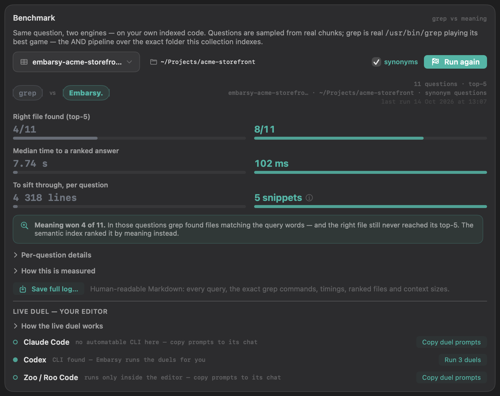</p>

On a real production monolith, in this run:

- **Right file found:** semantic **8/11** vs grep 4/11 — with the file ranked **#1** most of the time
- **Time to a ranked answer:** **102 ms** vs 7.74 s — ~75× faster, per question
- **What your agent must read:** **5 ranked snippets** vs 4,318 matching lines of grep noise

That last line is the real product: every grep line your agent "sifts" is context-window budget and
tokens you pay for. Five already-relevant snippets *are* the understanding.

**And it's honest.** The benchmark refuses to run if the index doesn't match the folder. grep is
never made to scan folders the index doesn't cover. Every grep command is shown verbatim and
copy-pasteable. A **synonyms mode** swaps one word per question for a synonym — the paraphrase test
literal search can't ace by construction. And **Save full log…** exports a human-readable Markdown
report — every query, exact commands, timings, ranked files, context sizes — so you can re-check
every number by hand. There's even a **live duel** mode that runs the same questions end-to-end
through your own coding agent, with and without Embarsy, and compares wall-clock time and tokens.

---

## One memory for every agent — under your control

Claude Code, Codex and Zoo / Roo each keep their own skills, rules and memories — in different
folders, in different formats. Embarsy gives them **one memory base**: a plain folder of Markdown
(`~/EmbarsyMemory`) that every agent reads, published into each agent's own folders as links.

**Your profile, in every session.** Who you are, who your agent is, your standing rules — written
once in **Memory → Core**, loaded by every agent at the start of every session, kept under 4 KB.

<p align="center">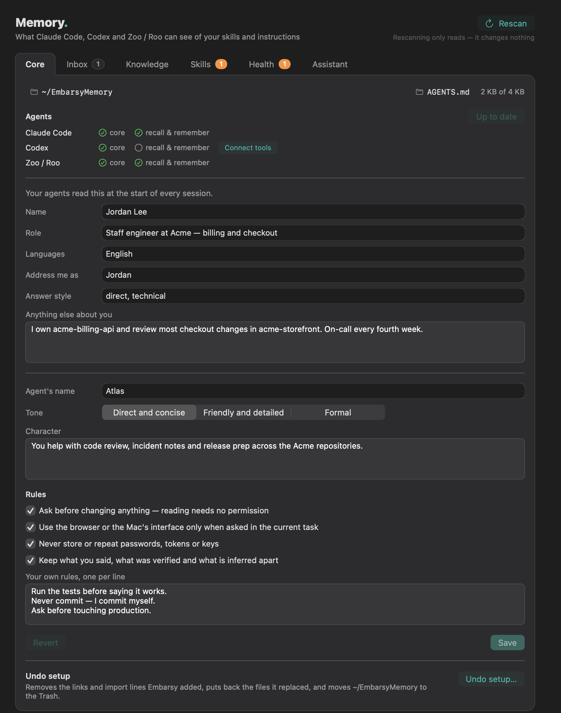</p>

**Skills every agent actually loads.** Each agent has its own loader rules — how deep it looks, what
the name must match, how strictly it reads YAML. Embarsy checks every skill against each one and
shows a check per agent, or exactly why that agent skips it.

<p align="center">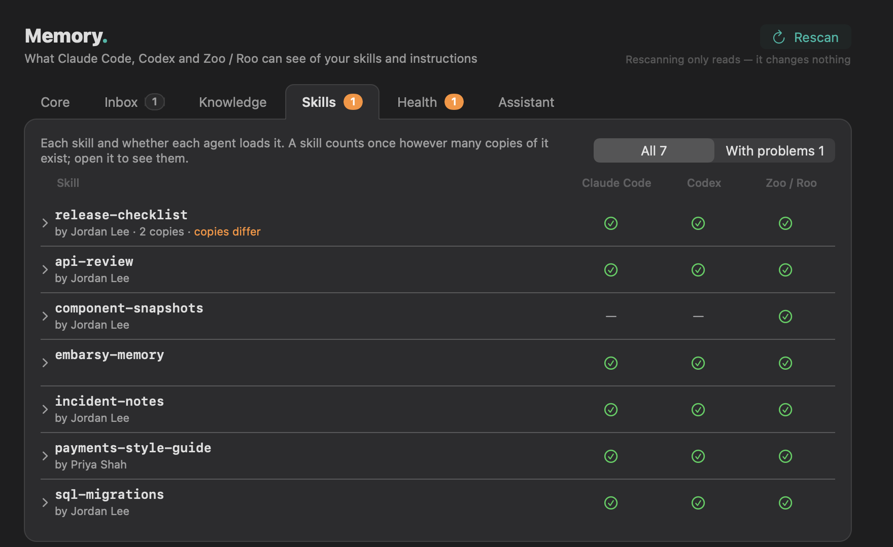</p>

**Health that fixes things.** Broken links, copies that drifted apart, a skill only one agent sees,
someone else's skill edited in place, notes that disagree, a profile over budget. Every finding says
what to do; most have a button — **Publish**, **Bring into the base**, **Fix links**, **Merge** — and
for the rest **Ask the assistant** drafts a fix with the local model. Only files inside the base are
edited, and each change is a commit in the base's history.

<p align="center">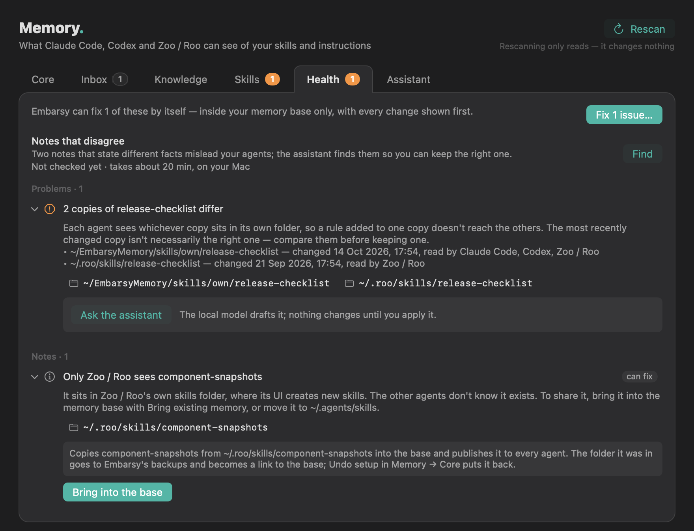</p>

**Agents remember through you.** With Embarsy's tools connected, agents call `recall` to search the
memory by meaning and `remember` to propose a new fact. Proposals wait in the **Inbox** — with a hint
from your earlier decisions — and become memory only when you accept them. **Knowledge** lets you
read and search the whole base without leaving Embarsy.

<p align="center">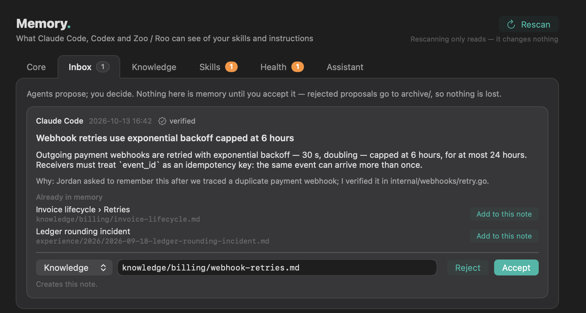</p>

<p align="center">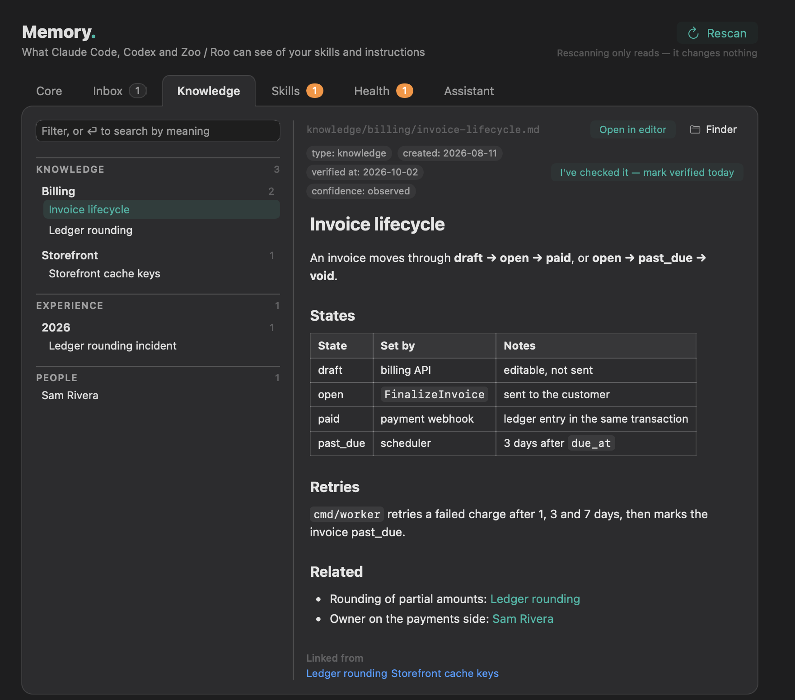</p>

**Bring what you already have.** **Bring existing memory** finds the skills, instructions and
memories your agents already keep, groups copies of each skill and flags the ones that drifted
apart. Your own agent — or the local model — sorts them into a plan; you review every item before
anything moves. Old copies go to backups and become links; **Undo setup** puts it all back.

---

## A local assistant that sorts and maintains your memory

The memory work above doesn't need a cloud agent. **Memory → Assistant** downloads a Qwen sized
for your Mac (Qwen&nbsp;3.6 35B-A3B on 48&nbsp;GB) and runs it in the Ollama that ships inside
Embarsy:

- **Moves your memory in** — sorts your existing skills, files and journal entries into the base, condenses
  your profile, and writes the same plan an agent would. On a real migration it agreed with Claude's
  plan on about nine items in ten.
- **Catches outdated facts** — finds notes that state different facts about the same thing (an old fix
  one note still recommends, a version another note says was dropped) and lets you pick the right one.
- **Drafts the fixes that need judgment** — shortens a profile over its budget or a description an
  agent would reject, explains which of two drifted copies to keep, suggests a name that doesn't clash.

It **costs nothing while idle**: downloaded, it's only disk space; it loads when Embarsy asks it
something and leaves memory after the idle time you choose. The tab shows whether it's in memory
right now, with **Unload now**; the embedding model behind the code index works the same way, in
Settings. Until the model is downloaded, the tab says so, and wherever the assistant could help —
Health, the migration — a **Set up the assistant** button leads there.

<p align="center">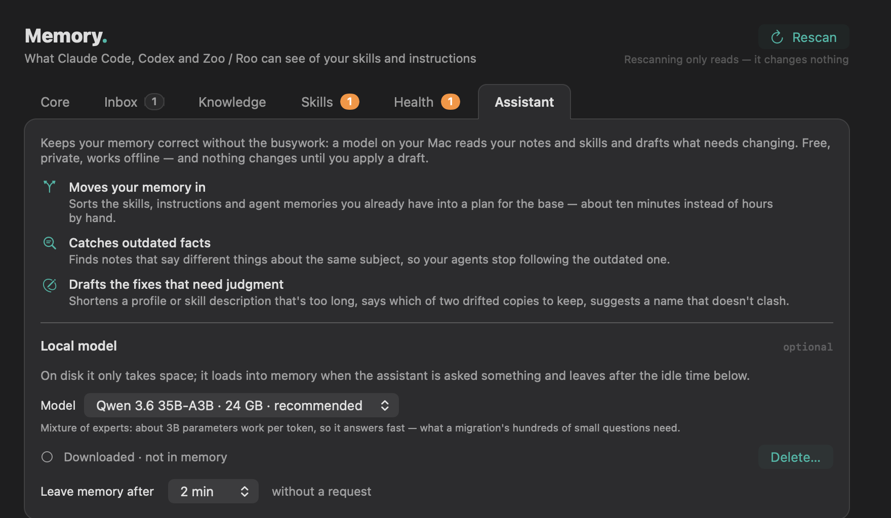</p>

The whole interface speaks **English and Russian** (Settings → Language).

---

## Simple. Clear. Transparent.

**Simple** — one button installs and wires the entire stack: Qdrant, Ollama, the
`qwen3-embedding` model. No terminal, no Docker, no Python, no API keys to mint. Claude Code and
Codex connect with one more click; Zoo / Roo Code get copy-paste connection values. **Start fresh**
sets up the memory base in a few questions.

**Clear** — you always see which skill each agent loads, what's indexed (per-project clusters with
languages and areas), what it costs your machine (live CPU, memory, temperature), and what's
happening right now (every search, embedding and vector operation, streamed).

**Transparent** — the numbers are measured on your code, the memory is plain Markdown with its own
git history, the logs are exportable, and everything runs on `127.0.0.1`. No cloud. No telemetry.
No trust required.

---

## Highlights

### ① One-click install of the entire stack

No terminal, no Docker, no Python setup. Embarsy downloads and wires up the whole local stack —
**Qdrant**, **Ollama** and the **`qwen3-embedding`** model — from a single button, then verifies every
service is healthy before it reports ready.

<p align="center">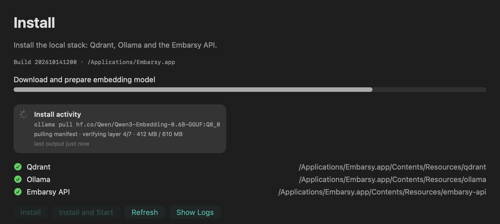</p>

### ② Connect Claude Code, Codex and Zoo / Roo — nothing to install

**Connections** has a tab per agent. **Connect** writes the editor's own config for you, and the MCP
bridge and Node ship inside Embarsy — no npm, no setup command. One connection gives the agent both
halves: `search_code` over your indexed folders, and `recall` / `remember` over your memory. Add the
folders your agents should know with **Add folder…**; the memory base is indexed on its own.

<p align="center">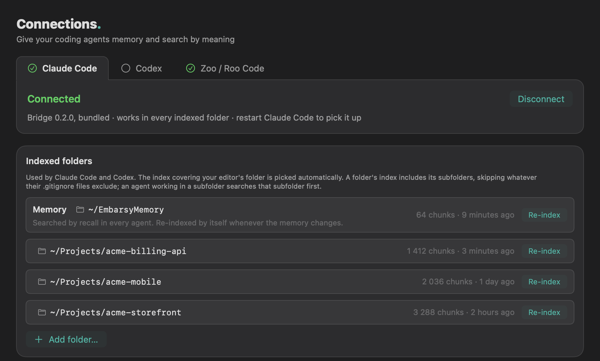</p>

### ③ Code search: what's indexed, who's searching, what it costs

**Code search** gathers the index in three tabs:

- **Code index** — every project as a collection, led by its name (click it to reveal the folder in
  Finder), with languages, areas and point totals. Slide **`‹‹‹ delete`** to reclaim a project's
  vector storage.
- **Search requests** — every request labelled with the client that made it and whether it was
  indexing or searching, so "is this editor even wired up?" stops being a guess.
- **Load** — embedding throughput, latency, Qdrant reads/writes/errors, plus live memory, CPU and
  temperature of the stack, over the last hour, day or week.

<p align="center">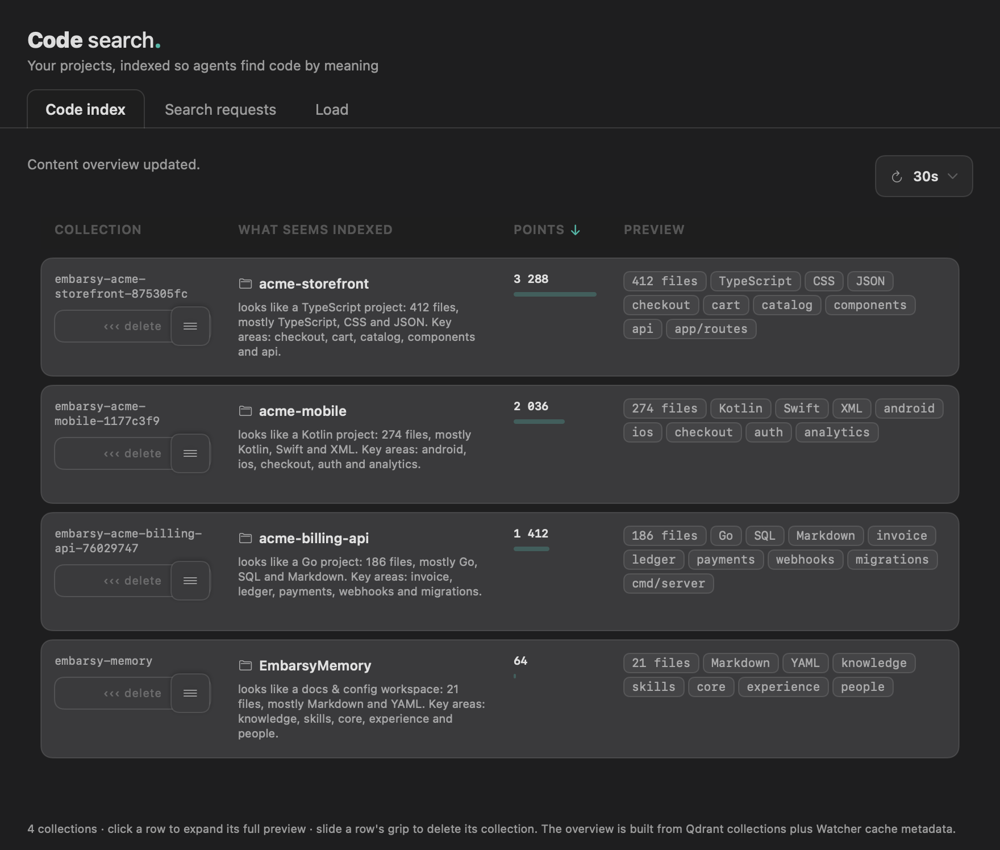</p>

<p align="center">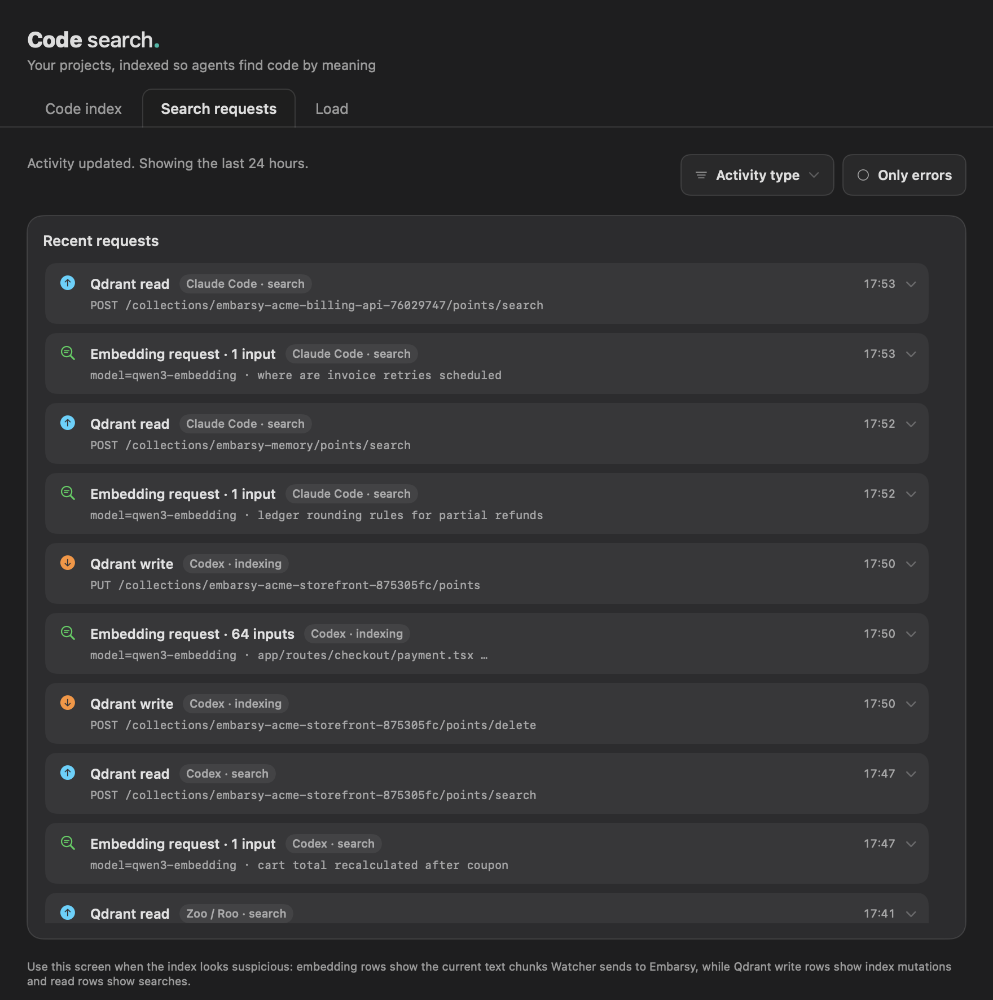</p>

<p align="center">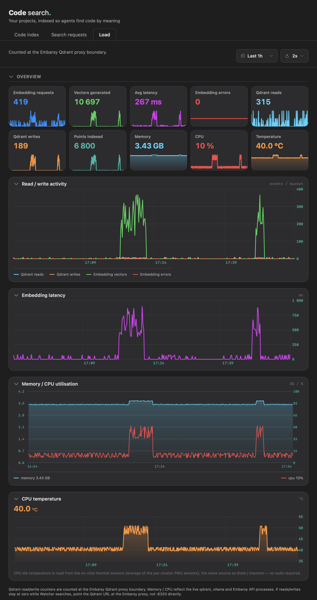</p>

### ④ Start &amp; stop the whole stack — one button, or the menu bar

Run everything with **Start All**, or control the stack straight from the macOS **menu bar** —
Start, Stop, Refresh and open your project, all a click away. Services keep running when Embarsy
restarts, and Embarsy picks them up again. One button removes every component — database, model,
secrets — leaving your Mac exactly as it was.

<p align="center">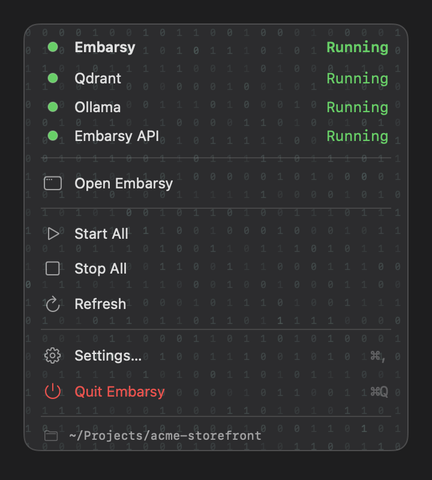</p>

---

## How it works

| Component | Role | Where |
| --- | --- | --- |
| **Qdrant** | Vector database — the code index and the memory index | `127.0.0.1:6333` |
| **Ollama** | Runs `qwen3-embedding`, and the optional local Qwen | `127.0.0.1:11434` |
| **Embarsy API** (FastAPI) | OpenAI-compatible `/v1/embeddings` + a Qdrant proxy | `127.0.0.1:8000` |
| **MCP bridge** | `search_code`, `recall`, `remember`, `memory_status` … for your agents | bundled |
| **Memory base** | Plain Markdown with a git history, published to agents as links | `~/EmbarsyMemory` |

**Embarsy manages the infrastructure** and hands you the exact connection values to paste in — the
embeddings endpoint is OpenAI-compatible, so anything that speaks it just works. Everything runs on
`127.0.0.1`; **no cloud, no telemetry, no data leaves your Mac.**

Two ways in, depending on your agent:

- **Claude Code / Codex** connect with one click in **Connections** — nothing to install. Embarsy ships
  its own MCP bridge, registers it with the editor, and indexes the folders you add. The bridge tells
  the agent when to search by meaning and when grep is still the better tool, and says so plainly
  when a match is weak.
- **Roo Code / Zoo Code** have code indexing built in — paste the connection values and you're done.
  **Connect** on their tab adds the same bridge for memory.

---

## Quick start

1. Download the latest **`Embarsy-*.dmg`** from [Releases](../../releases).
2. Drag **Embarsy** into Applications.
3. **First open.** Embarsy is a self-signed beta, so macOS Gatekeeper stops it once:
   - Double-click **Embarsy**; if the dialog offers **Open**, click it.
   - If it's blocked, go to **System Settings → Privacy & Security**, scroll to the bottom and click
     **Open Anyway**, then launch again.
   - Still blocked (or it says the app is "damaged")? Clear the download quarantine once, then launch:
     ```bash
     xattr -dr com.apple.quarantine /Applications/Embarsy.app
     ```
4. Open **Install → Install and Start**. Embarsy fetches Qdrant, Ollama and the embedding model, then
   starts the stack (the first model download takes a few minutes).
5. Connect your agent in **Connections**:
   - **Claude Code / Codex** — click **Connect** on the agent's tab, add your project with
     **Add folder…**, then restart the editor.
<p align="center">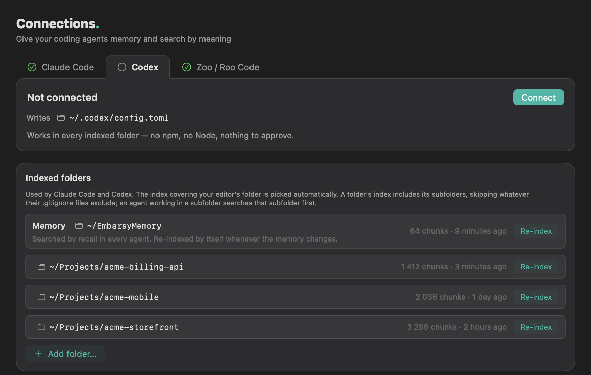</p>

   - **Roo Code / Zoo Code** — open the **Zoo / Roo Code** tab and copy the connection values into
     the editor's codebase-indexing settings. Point the **Qdrant URL** at the Embarsy proxy so
     Code search → Load can count reads/writes.
<p align="center">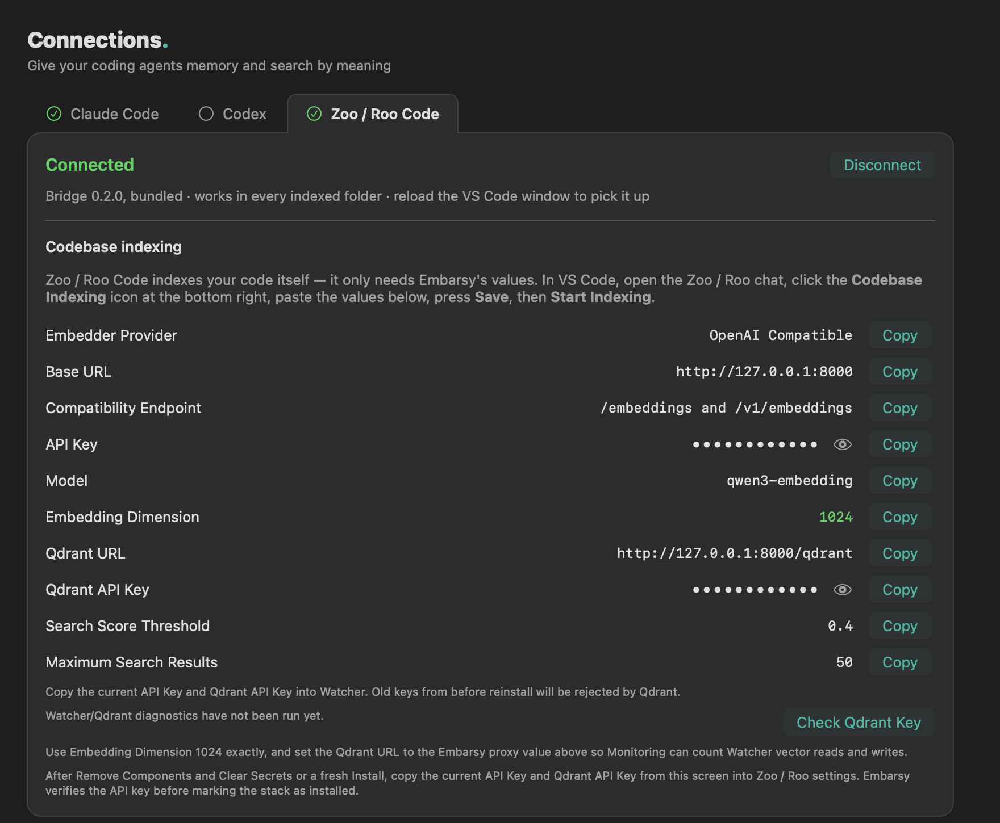</p>

6. Set up **Memory**: **Start fresh** answers a few questions about you and your agent; **Bring
   existing memory** moves in what your agents already keep. Then **Publish** in **Memory → Core**.
7. Optional: **Memory → Assistant → Download** for migration and memory upkeep without a cloud agent.
8. Scroll down on **Status** and hit **Run benchmark** — watch grep and meaning race on your own code.

<p align="center">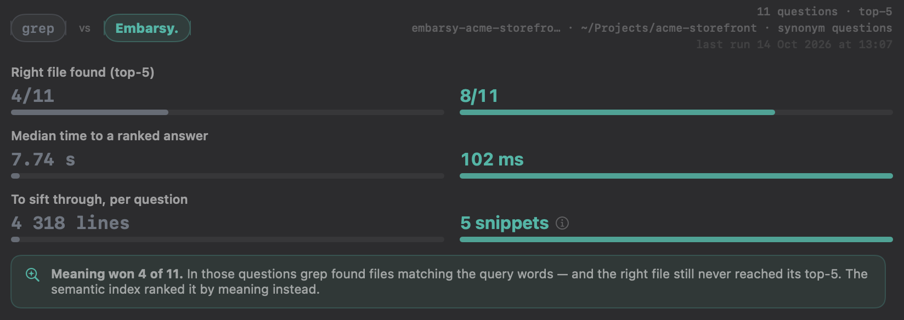</p>

---

## License

Embarsy is **source-available** under the **[PolyForm Strict License 1.0.0](LICENSE)** — **not** an
open-source license. It permits **noncommercial** use only; **selling, redistributing, or modifying**
the software requires a separate written license from the author.

Need a commercial or modification license? → **arsenyganov@gmail.com**

Bundled third-party components (Qdrant, Ollama, FastAPI, …) keep their own licenses — see
[THIRD_PARTY_NOTICES](THIRD_PARTY_NOTICES.md).

---

## Download

<p align="center">
  <a href="https://github.com/arsenyganov-pixel/embarsy-embedder/releases">
    
  </a>
  <br>
  <sub><code> · macOS 13+ · Apple Silicon · free beta · </code></sub>
</p>
